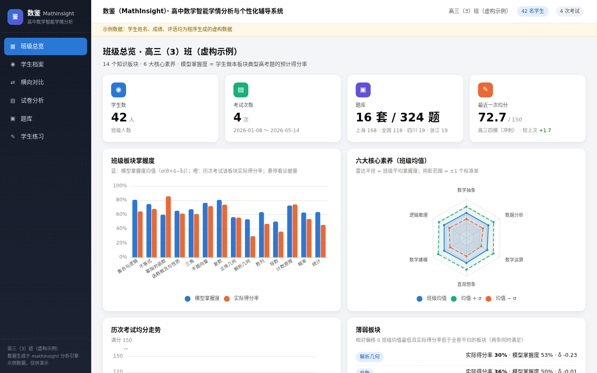
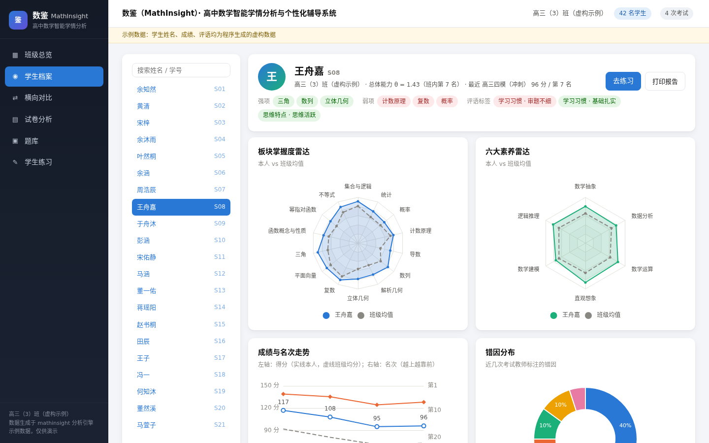
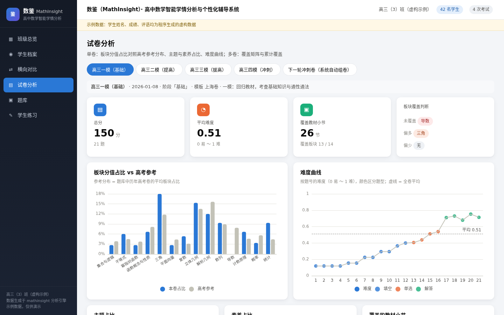
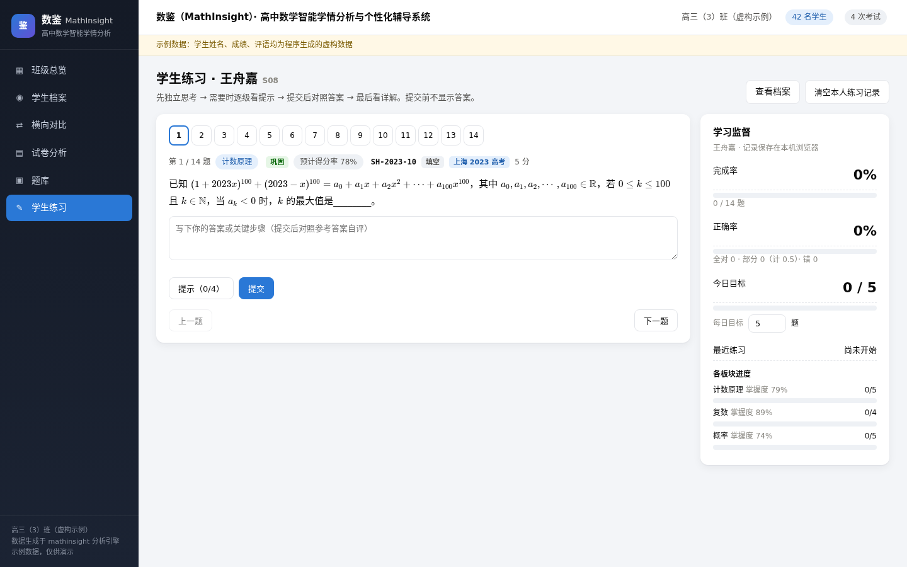
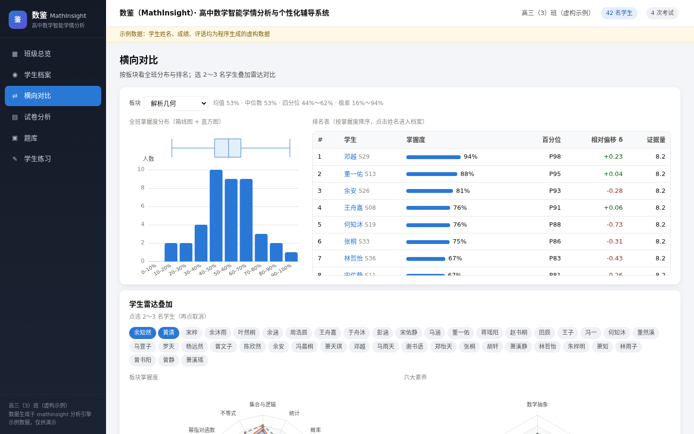
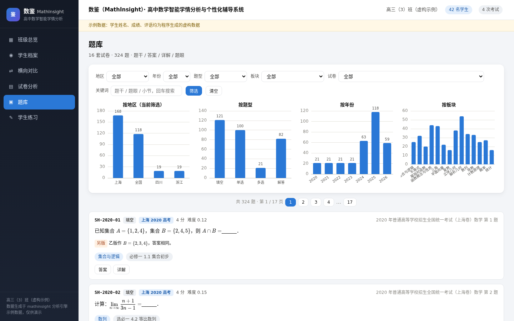
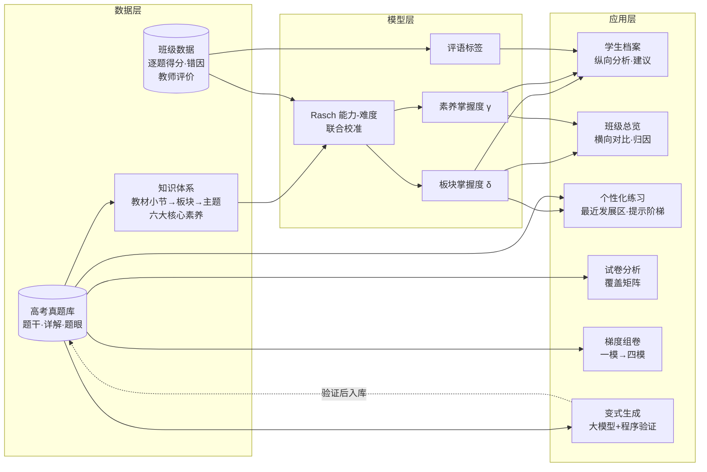

<div align="center">

# 数鉴（MathInsight）

### 高中数学智能学情分析与个性化辅导系统

**看清每一个学生，也看清整个班级。**
以高考真题库为底座，用统计模型把每一次考试变成可执行的教学决策。

<p>


</p>

**[🌐 在线演示](https://maxingan2412.github.io/MathInsight/)** · [功能](#-核心功能) · [截图](#-界面预览) · [架构](#-系统架构) · [快速开始](#-快速开始) · [方法](docs/设计说明.md) · [路线图](#-路线图) · [许可](#-许可)

</div>

---

## ✨ 核心功能

<table>
<tr>
<td width="50%" valign="top">

### 📚 高考真题库
* 上海卷 2020–2026、新课标全国卷 2024–2026 及多地模拟卷，**逐题配有详解**
* 每题标注**教材小节、板块、课标主题、六大核心素养权重**
* 每题提炼「**题眼**」：卡点在哪、哪一步打通
* 导入程序可持续扩充各省市题库

</td>
<td width="50%" valign="top">

### 🧑‍🎓 学生学情档案
* 由**逐题得分 + 教师主观评价**自动建档
* 14 个板块、6 大素养的掌握度与班内百分位
* 强项 / 弱项、错因分布、成绩与名次走势
* 评语自动打标签，生成**个性化提升建议**

</td>
</tr>
<tr>
<td valign="top">

### 🔍 横纵对比与归因
* **纵向**：同一学生各板块、各素养的相对强弱
* **横向**：同一板块全班分布与排名，学生之间叠加对比
* **归因**：班级薄弱板块的失分，究竟源于运算、推理还是审题——模型证据与教师错因**交叉印证**，并定位到最弱的教材小节

</td>
<td valign="top">

### 🎯 个性化练习
* 针对弱板块推题，难度落在**最近发展区**（预测得分率 60%–85%），另配挑战题
* **提示阶梯**：方向 → 卡点 → 打通，先思考后看答案
* 学生端在线练习、**自动判分**、进度与学习监督
* 大模型生成**同构变式题**（铺垫 / 巩固 / 拔高），附程序自动验证

</td>
</tr>
<tr>
<td valign="top">

### 📝 试卷分析
* 每张卷子的板块、主题、素养分值分布，与历年高考对照
* 难度曲线；未覆盖、偏多、偏少的板块一目了然
* 多次考试的**覆盖矩阵**，避免考查重点重复

</td>
<td valign="top">

### 🧩 梯度组卷
* 按卷型模板自动组卷：**一模基础 → 二模提高 → 三模拔高 → 四模冲刺**
* 冲刺卷整体难度略高于高考，让学生在考场上游刃有余
* 板块分值贴近高考分布，自动避开已考过的题

</td>
</tr>
</table>

## 🖥 界面预览

> **在线体验：<https://maxingan2412.github.io/MathInsight/>**（无需安装，浏览器直接打开）
>
> 截图与在线演示中的班级为程序生成的**虚构示例**，学生姓名、成绩与评语均非真实数据。

| 班级总览 | 学生档案 |
|:---:|:---:|
|  |  |
| **试卷分析与梯度组卷** | **学生练习（提示阶梯）** |
|  |  |
| **横向对比** | **真题库** |
|  |  |

## 🏗 系统架构



**模型要点**（详见 [设计说明](docs/设计说明.md)）：

* 学生 s 在题 i 上的得分率 ~ σ(θ_s + Σ a_iu·δ_su − b_i)，联合估计能力、难度与板块偏移；难度以历年高考题位为常模。
* 班级归因 = 模型证据（全班素养偏移 × 板块素养权重）与教师证据（错因分布）的加权合成。
* 推题以模型预测得分率为准，落在 60%–85% 的「最近发展区」。

## 🚀 快速开始

```bash
git clone https://github.com/maxingan2412/MathInsight.git
cd MathInsight
pip install numpy            # 核心分析只依赖 numpy

# 1. 生成虚构示例班级（42 人、4 次考试）
python scripts/make_demo.py

# 2. 运行完整分析，导出网页数据
python -m mathinsight analyze examples/demo_class

# 3. 打开网页端（双击即可，无需服务器）
open web/index.html          # Windows: start web\index.html
```

常用命令：

```bash
python -m mathinsight bank                              # 题库概况
python -m mathinsight student examples/demo_class S08   # 单个学生的诊断与练习建议
python -m mathinsight paper   examples/demo_class M4    # 一次考试的试卷分析
python -m mathinsight build   --stage 冲刺 --template 新高考卷   # 自动组一张冲刺卷
python -m mathinsight variants SH-2024-18 --level 拔高 --dry     # 查看变式生成提示词
```

用自己的班级：按 [设计说明](docs/设计说明.md) 第 2 节 准备四个文件（Excel 导出 CSV 即可），把目录传给 `analyze`。

## 📊 数据现状

| 类别 | 内容 | 套数 | 题数 |
|---|---|:---:|:---:|
| 上海高考 | 2020–2026 秋考 | 7 | 147 |
| 全国高考 | 新课标Ⅰ卷 2024–2026、Ⅱ卷 2025–2026、全国甲卷（理）2024 | 6 | 118 |
| 模拟考试 | 上海徐汇一模、成都三诊、宁波一模（2025 届） | 3 | 59 |
| **合计** | | **16** | **324** |

每道题都有完整详解、教材小节与素养标注；题干字句尚待与原卷逐字核对的 17 道题已单独标记，组卷与推题默认不使用。

## 🗺 路线图

- [x] 高考真题库与知识体系、素养标注
- [x] Rasch 学情模型、板块与素养掌握度
- [x] 个体纵向分析、班级横向对比与归因
- [x] 试卷分析、多卷覆盖矩阵、梯度组卷
- [x] 个性化推题（最近发展区 + 提示阶梯）与学生练习端
- [x] 大模型变式生成接口（程序验证）
- [ ] 题库扩充至近 15 年各省市高考卷，并收录强基计划试题
- [ ] 变式题教师审核工作流，审定后自动入库
- [ ] 知识追踪模型升级（BKT / DKT），支持练习数据实时更新掌握度
- [ ] 答题卡拍照识别，自动录入逐题得分
- [ ] 学生与家长的阶段学情报告

## 📁 目录结构

```
MathInsight/
├── mathinsight/        核心包：题库、知识体系、模型、分析、推荐、组卷、变式、导出
├── bank/               结构化题库（papers.json、questions.jsonl）
├── data/               教材小节表
├── examples/demo_class 虚构示例班级
├── scripts/            题库导入、示例数据生成
├── web/                静态网页端（离线可用）
├── docs/               设计说明与截图
└── tests/              端到端测试
```

## 📄 许可

本项目采用 [CC BY-NC-ND 4.0](LICENSE)（署名 - 非商业性使用 - 禁止演绎）。**禁止任何商业使用，禁止修改后再发布**；转载、二次开发或商业合作请先取得作者书面许可。题目来源、第三方组件与免责声明见 [NOTICE](NOTICE.md)。
